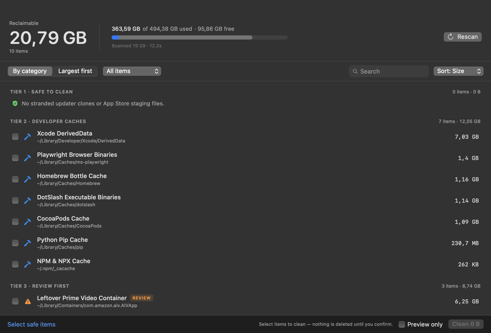
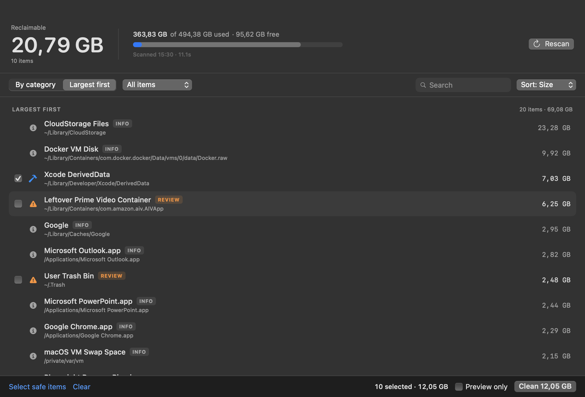

# MacOS Storage Optimiser 🧹

> Native macOS utility to audit, diagnose, and safely reclaim 50–100+ GB of hidden **"System Data"** bloat.
> Two front ends, one safety engine: a zero-dependency Zsh CLI (`macos-system-data`) and a native SwiftUI app.

Read-only audit by default. No third-party dependencies in either front end.

[](https://github.com/merajc/macos-storage-optimiser/actions)
[](https://opensource.org/licenses/MIT)
[](https://apple.com)

---

## The Problem

macOS frequently reports 50–150+ GB of storage consumed by **"System Data"** in *System Settings > General > Storage*, giving users no transparency into what is actually consuming space.

Most of this storage is not the macOS operating system. It is composed of:
1. **Darwin Temp Directory Leaks**: Chromium & Electron background updaters (Google Chrome, Microsoft Teams, Brave, Slack) leaking dozens of duplicate ~1.3 GB code-sign bundles in `/var/folders/*/*/X`.
2. **App Store Staging Caches**: Stranded multi-gigabyte pkg/ipa downloads in `/var/folders/*/*/C`.
3. **Developer Caches**: Stranded NPM (`~/.npm`), Homebrew bottles, Playwright browser downloads, DotSlash binaries, and Xcode `DerivedData`.
4. **App Virtual Disks & Caches**: Abandoned Android emulators (BlueStacks in `/Users/Shared`), Adobe Camera Raw preview databases, and container caches.
5. **APFS Local Snapshots & VM Swap**: Hidden Time Machine local snapshots locking deleted disk blocks.

---

## Installation

### Option 1: Quick Install (curl)
```bash
curl -fsSL https://raw.githubusercontent.com/merajc/macos-storage-optimiser/main/install.sh | bash
```

### Option 2: Clone & Make
```bash
git clone https://github.com/merajc/macos-storage-optimiser.git
cd macos-storage-optimiser
make install
```

---

## Quick Usage

### 1. Read-Only Audit (Default)
Safely inspect and report all System Data culprits across your drives:
```bash
macos-system-data
```

### 2. Disk Overview
```bash
macos-system-data --summary
```

### 3. Interactive Cleanup Wizard
Step-by-step confirmation prompts for each category:
```bash
macos-system-data --clean
```

### 4. Non-Destructive Dry Run
Preview exactly what would be removed without touching disk:
```bash
macos-system-data --dry-run --clean
```

### 5. Automated / Unattended Cleanup
Purge 100% safe runaway temporary bugs (Chrome code-sign clones, App Store staging):
```bash
macos-system-data --clean-tier1 -y
```

Purge developer build & package caches (NPM, Brew, Playwright, DotSlash, Pip, Xcode):
```bash
macos-system-data --clean-dev -y
```

---

## Desktop App: MacOS Storage Optimiser

A native SwiftUI dashboard on top of the same engine. It shells out to the bundled Zsh script, so the safety allowlist is identical: the UI can only act on catalogued item IDs, never on arbitrary paths.



### Build & run

```bash
make app    # builds dist/MacOS Storage Optimiser.app (ad-hoc signed)
make run    # builds and opens it
```

Requirements: macOS 14+ and Xcode Command Line Tools. The app is not notarized — on first launch use **right-click → Open** (or `xattr -dr com.apple.quarantine "dist/MacOS Storage Optimiser.app"`).

### What it does

- **Streams the audit** as each item is measured instead of waiting for the full run.
- **By category** and **Largest first** views. Largest first sorts every measured item by size regardless of tier, so the real space hogs (Docker disk, CloudStorage, device backups, app bundles) surface immediately.
- Selectable rows (cleanable items only) with a confirmation sheet; review-tier items require typing `delete`.
- **Preview only** toggle routes everything through `--dry-run`.
- Paths blocked by macOS report **permission denied** instead of looking "clean", with a shortcut to Full Disk Access settings.
- Audit trail at `~/Library/Logs/MacOS Storage Optimiser/clean.log`.



---

## Machine-Readable Output (agents & automation)

`--json` streams newline-delimited JSON (NDJSON), so tools never need to scrape the human report.

```bash
macos-system-data --json
```

```json
{"type":"meta","schema":1,"version":"1.1.0","mode":"audit","platform":"macOS","darwinBase":"/var/folders/…"}
{"type":"disk","totalBytes":494384795648,"usedBytes":362255724544,"freeBytes":97192501248,"usedPercent":79}
{"type":"item","id":"xcode-deriveddata","tier":2,"safety":"safe","label":"Xcode DerivedData","state":"present","bytes":7025188864,"count":1,"cleanable":true,"paths":["/Users/…/DerivedData"]}
{"type":"insight","kind":"heavy-cache","id":"heavy-cache:Google","label":"Google","bytes":2762403840,"path":"/Users/…/Caches/Google","catalogued":false}
{"type":"done","reclaimableBytes":20788097024,"reclaimableItems":10,"elapsedMs":10000}
```

`state` is `present`, `missing`, or `denied` — a denied path is **not** the same thing as an empty one.

### Cleaning by ID

```bash
macos-system-data --json --clean-ids xcode-deriveddata,trash -n   # preview only
macos-system-data --json --clean-ids xcode-deriveddata -y         # delete
```

Valid IDs: `code-sign-clones`, `appstore-staging`, `npm-cache`, `brew-cache`, `playwright`, `dotslash`, `pip`, `xcode-deriveddata`, `sim-caches`, `gradle`, `yarn`, `cocoapods`, `bluestacks`, `adobe-raw`, `diagnostic-reports`, `trash`, `prime-video-container`.

`--clean-ids` is non-interactive by design: it refuses to run without `-y` (or `-n` for a preview), and every deletion still passes through the canonicalized allowlist. Unknown IDs exit `2` before anything is touched.

### Exit codes

| Code | Meaning |
|---|---|
| 0 | Success |
| 2 | Usage error (unknown flag/ID, interactive prompt required while `--json` is set, `--clean-ids` without `-y`/`-n`) |
| 3 | Cleanup ran but at least one item failed |

---

## Detection & Cleanup Tiers

| Tier | Category | Targets Cleaned | Safety |
|---|---|---|---|
| **Tier 1** | **Stranded OS & App Bugs** | Chromium/Teams `.code_sign_clone` bug dumps, App Store download staging | 🟢 100% Safe |
| **Tier 2** | **Developer Caches** | `~/.npm`, Homebrew, Playwright, DotSlash, Pip, Xcode `DerivedData`, CoreSimulator, Gradle, Yarn, CocoaPods | 🟢 Safe (Re-downloadable) |
| **Tier 3** | **Virtual Disks & App Bloat** | BlueStacks Android VM (`/Users/Shared`), Adobe Camera Raw cache, Trash, Crash Logs, Prime Video container | 🟡 Interactive Prompt |
| **Tier 4** | **System Diagnostics** | APFS Local Snapshots, macOS VM swap, Spotlight > 1 GB index, heavy `~/Library/Caches` | 🔵 Read-Only Insights |

---

## Safety Architecture

- **Read-Only by Default**: Running `macos-system-data` with no arguments never modifies or deletes any files.
- **Strict Allowed Roots**: Deletions are strictly confined to verified cache, temp, and runtime build roots.
- **Path Traversal Defense**: All targets are canonicalized via realpath resolution (`:A`) and checked against a blacklist (`/`, `/System`, `/Library`, `/Users`, `/Users/Shared`, `$HOME`, etc.).
- **Dry Run Support**: Test any cleanup operation safely using `--dry-run` or `-n`.
- **ID-Only API**: `--clean-ids` accepts catalogued IDs, never paths. The desktop app is a thin driver over this, so it cannot widen the allowlist.
- **Denied ≠ Clean**: Unreadable paths report `denied`/permission errors rather than `0B`, so Full Disk Access gaps are visible instead of silently "clean".
- **Zero External Dependencies**: Implemented in clean, native Zsh. No Python, Node, or third-party binaries required.

---

## License

MIT © [Meraj Chhaya](https://github.com/merajc)
